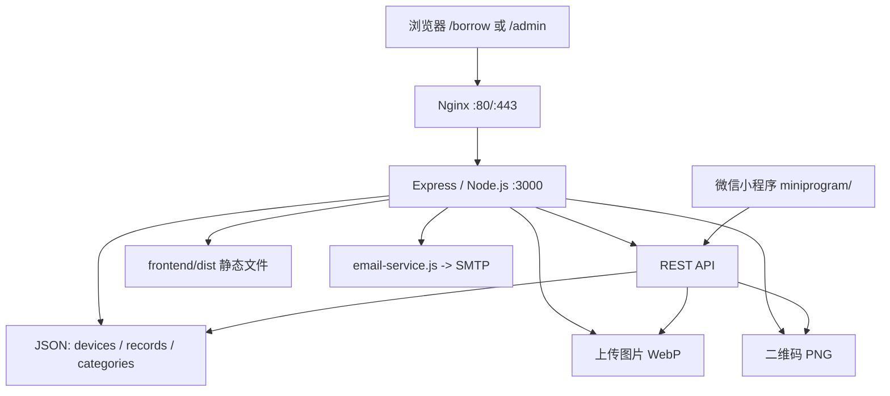

# 设备管理项目代码结构与定位指南

> 最后更新：2026-08-31
> 适用版本：当前本地工作区（网页端 UX、管理员邮件通知、原生微信小程序普通用户端）  
> 用途：回答“一个需求应该改哪里、会影响什么、用什么验证”。产品规则以 [`PROJECT_GUIDE.md`](PROJECT_GUIDE.md) 为准，短期进度以 [`CURRENT_STATUS.md`](CURRENT_STATUS.md) 为准。

## 1. 先看结论

这是一个轻量单体应用：一个 Node.js/Express 进程同时提供 REST API、静态前端、上传图片和二维码；浏览器端使用 Vue 3，但暂未拆成 `.vue` 单文件组件。

网页端代码主要集中在三个文件；微信小程序位于独立的 `miniprogram/` 目录：

| 文件 | 主要职责 | 修改前优先搜索的锚点 |
|---|---|---|
| `server.js` | 环境配置、JSON 持久化、安全中间件、图片处理、全部 API、页面入口 | `// ====================`、具体路由字符串 |
| `email-service.js` | 内置 SMTP 客户端和 UTF-8 纯文本邮件组装 | `sendSmtpMail`、`SmtpConnection` |
| `frontend/src/main.js` | 用户借还页、管理后台、浏览器端状态和接口调用 | `const BorrowPage`、`const AdminPage`、函数名、模板注释 |
| `frontend/index.html` | HTML 入口、全局 CSS、响应式与动画 | `/* ============ 借还页`、`弹窗 & 表单`、`管理后台`、`动画` |
| `miniprogram/services/api.js` | 小程序统一请求、API 地址、图片地址和日期格式化 | `request`、`assetUrl` |
| `miniprogram/pages/*` | 小程序普通用户列表、详情、借用表单、归还查询页面 | `pages/borrow`、`pages/detail`、`pages/borrow-form`、`pages/return` |

不要先通读这三个大文件。先从本文“需求到文件”表选择入口，再搜索锚点并读取相邻代码。

## 2. 高层运行结构



本地开发时，`npm run dev` 直接运行 `node server.js`。如果 `frontend/dist/index.html` 存在，Express 会优先提供构建产物；否则回退到 `frontend/` 源入口。因此修改前端源码后，仅重启 `npm run dev` 仍可能看到旧页面，必须先执行 `npm run build`，或在后端运行于 `3000` 时另开终端运行 `npm run dev:frontend`，通过 Vite 地址查看源码热更新。Vite 会把 `/api`、`/uploads`、`/qrcodes` 代理到 `localhost:3000`。

## 3. 需求到文件的快速定位

| 需求类型 | 首要文件 | 常用搜索锚点 | 配套验证 |
|---|---|---|---|
| 用户端借用流程 | `frontend/src/main.js` | `const BorrowPage`、`doBorrow` | `test/frontend-source.test.js`、`test/server.test.js` |
| 用户端归还流程 | `frontend/src/main.js`、`server.js` | `lookupReturns`、`doReturn`、`return-lookup` | 同上 |
| 管理员邮件通知 | `server.js`、`email-service.js`、`frontend/src/main.js` | `normalizeEmailSettings`、`queueEmailNotification`、`sendSmtpMail`、`email-notifications` | `test/email-service.test.js`、`test/email-notification.test.js`、`test/server.test.js` |
| 搜索、分类筛选、设备卡片 | `frontend/src/main.js` | `portal-chips`、`filteredDevices`、`categoryIcon` | `test/frontend-source.test.js` + 用户手动浏览器检查 |
| 用户端布局、颜色、导航、动画 | `frontend/index.html` | `.portal-`、`借还页`、`prefers-reduced-motion` | `test/frontend-source.test.js` + 用户手动桌面/移动检查 |
| 管理端页面或交互 | `frontend/src/main.js` | `const AdminPage`、对应函数名 | `test/frontend-source.test.js` + 用户手动浏览器检查 |
| 管理端样式 | `frontend/index.html` | `管理后台`、`.admin-`、`.device-card` | 用户手动浏览器检查 |
| 设备 CRUD/上下线 | `server.js` | `设备 CRUD API`、`/api/devices` | `test/server.test.js` |
| 分类 CRUD | `server.js`、`frontend/src/main.js` | `分类 API`、`分类管理` | `test/server.test.js`、`test/frontend-source.test.js` |
| 借还记录、归档、恢复 | `server.js` | `借还记录 API`、具体路由 | `test/server.test.js` |
| 登录、会话、权限 | `server.js`、`frontend/src/main.js` | `checkAdmin`、`sessions`、`doLogin` | `test/security-config.test.js`、`test/server.test.js` |
| 上传与图片优化 | `server.js`、`frontend/src/main.js` | `optimizeUploadedImage`、`onImageChange`、`saveDevice` | `test/server.test.js`、`test/build-config.test.js` |
| 二维码 | `server.js`、`frontend/src/main.js` | `/api/qrcode/portal`、`generateDeviceQR` | `test/server.test.js` |
| CSP、限流、安全头 | `server.js` | `cspDirectives`、`loginLimiter`、`borrowReturnLimiter` | `test/security-config.test.js` |
| 构建、Vue 入口、代理 | `vite.config.js`、`package.json` | `build`、`server.proxy`、`alias` | `test/build-config.test.js`、`npm run build` |
| systemd、Nginx、生产目录 | `deploy/`、`DEPLOY.md` | 服务名或目录名 | `nginx -t`、`systemctl status` |
| 增量同步生产服务器 | `skills/sync-device-management/SKILL.md` | 按 Skill 执行 | Skill 给出的同步与生产验证步骤 |
| 微信小程序列表、筛选和图片 | `miniprogram/pages/borrow/`、`miniprogram/app.wxss` | `loadData`、`applyFilters`、`onImageLoad` | `test/miniprogram-source.test.js` + 微信开发者工具手动检查 |
| 微信小程序设备详情与借用 | `miniprogram/pages/detail/`、`miniprogram/pages/borrow-form/` | `loadDetail`、`submit` | 小程序源码契约测试 + 模拟器/真机手动检查 |
| 微信小程序归还流程 | `miniprogram/pages/return/` | `lookup`、`confirmReturn` | 小程序源码契约测试 + 真机手动检查 |

## 4. 目录结构

```text
设备管理/
├─ server.js                         # 后端、API、静态页面入口
├─ email-service.js                  # 无第三方依赖的 SMTP 客户端
├─ package.json                      # npm 脚本与依赖
├─ vite.config.js                    # Vite 构建、别名和开发代理
├─ frontend/
│  ├─ index.html                     # HTML 入口和全部全局 CSS
│  ├─ src/main.js                    # BorrowPage、AdminPage、根应用
│  └─ dist/                          # 构建产物，禁止手工修改
├─ miniprogram/                      # 原生微信小程序普通用户端（独立导入开发者工具）
│  ├─ config.js                       # AppID 与生产 API 基地址，不含 AppSecret
│  ├─ app.js/app.json/app.wxss        # 小程序入口、页面注册和全局样式
│  ├─ services/api.js                 # wx.request、图片地址和日期格式化
│  └─ pages/                          # borrow、detail、borrow-form、return 四个页面
├─ public/
│  ├─ assets/                        # 院徽、favicon 等源码静态资源
│  ├─ fonts/                         # Noto Sans SC 400/700 的本地 WOFF2 子集与许可证
│  ├─ js/                            # 用户端按需加载的静态动画脚本
│  │  ├─ anime.min.js                # Anime.js 2.2.0
│  │  └─ fireworks.js                 # 用户端 Canvas 点击粒子特效
│  └─ qrcodes/                       # 本地二维码输出，生产为持久化目录
├─ data/                             # 本地 JSON 数据，生产为持久化目录
├─ uploads/                          # 本地上传图片，生产为持久化目录
├─ test/
│  ├─ server.test.js                 # 后端集成与业务规则
│  ├─ email-service.test.js          # SMTP 协议和 UTF-8 邮件契约
│  ├─ email-notification.test.js     # 借用成功后的异步通知契约
│  ├─ frontend-source.test.js        # 前端源码契约
│  ├─ security-config.test.js        # 安全与生产配置
│  ├─ build-config.test.js           # 构建、依赖、静态资源
│  ├─ miniprogram-source.test.js      # 小程序配置、页面契约和图片加载样式
│  └─ fixtures/data/                 # 测试隔离数据
├─ deploy/
│  ├─ setup-server.sh                # 首次部署
│  ├─ device-management.service      # systemd 单元
│  ├─ device-management.env.example  # 生产环境变量模板
│  ├─ nginx.conf                     # Nginx 基础反代模板
│  └─ remove-orphan-device-records.sh# 定向数据修复脚本
├─ skills/sync-device-management/    # 项目专用增量同步 Skill
├─ docs/
│  ├─ CURRENT_STATUS.md              # 短期进度与部署状态
│  ├─ PROJECT_GUIDE.md               # 长期产品规则与架构约定
│  ├─ CODE_STRUCTURE.md              # 本文：代码定位地图
│  └─ plans/                          # 已确认的阶段设计
├─ README.md                          # 简短启动入口
├─ DEPLOY.md                          # 人工部署说明
└─ AGENTS.md                          # 项目协作规则
```

以下内容不是业务源码：`node_modules/`、`frontend/dist/`、测试截图与浏览器缓存、`.dev-*.log`/`.srv-*.log`、历史同步压缩包。排查功能时不要从这些产物反推源代码。

`vite.config.js` 将 `publicDir` 显式指向项目根目录的 `public/`，不是默认的 `frontend/public/`。Noto Sans SC 的本地 CSS 和 WOFF2 子集位于 `public/fonts/`，会随 Vite 构建进入 `frontend/dist/fonts/`，页面不再依赖 Google Fonts。

小程序不参与 Vite 构建，也不由 Express 静态页面路由托管。微信开发者工具应直接导入 `miniprogram/`；`project.config.json` 已写入 AppID `wx46f682f7e11b893d`，`config.js` 只保存公开的 `https://cyb3r.art` API 地址。小程序调用现有公开 API，不复制管理员会话，也不应把 AppSecret 放进目录。

## 5. 后端 `server.js`

### 5.1 启动与目录解析

文件顶部负责：

- 读取 `PORT`、`APP_BASE_URL`、`TRUST_PROXY` 和邮件凭据加密密钥 `EMAIL_CONFIG_KEY`。
- 将 `DATA_DIR`、`UPLOAD_DIR`、`QR_DIR` 解析为本地或生产路径。
- 生产环境缺少 `ADMIN_PASSWORD` 时拒绝启动。
- 在 `frontend/dist/index.html` 和 `frontend/index.html` 之间选择静态入口。
- 初始化 `devices.json`、`records.json`、`categories.json`、`operation-logs.json` 和 `email-settings.json`。

关键搜索锚点：`const DATA_DIR`、`const STATIC_DIR`、`initDataFile`。

### 5.2 安全、静态资源与上传链路

顺序如下：

1. Helmet/CSP 根据 `APP_BASE_URL` 是否为 HTTPS 决定 HSTS 和升级策略。
2. JSON 与表单体限制为 `32kb`。
3. `/uploads` 使用一年不可变缓存，`/qrcodes` 和前端静态资源由 Express 发布。
4. Multer 只接受 JPEG/PNG/WebP，单文件不超过 20 MB。
5. `validateUploadedImage` 校验文件签名。
6. `optimizeUploadedImage` 使用 Sharp 旋转、缩放并输出详情图和缩略图 WebP。

关键搜索锚点：`cspDirectives`、`IMAGE_EXTENSIONS`、`validateUploadedImage`、`optimizeUploadedImage`。

### 5.3 数据与兼容层

`readJSON`/`writeJSON` 直接同步读写 JSON。所有兼容规则集中在：

- `withDeviceCompatibility`：补齐分类、运营状态、图片缩略图与宽高。
- `withRecordCompatibility`：兼容旧 `department`/`notes` 字段。
- `findActiveRecord`：寻找未归还、未归档的当前记录。
- `maskName`、`maskPhone`、`toPublicBorrower`：公共接口脱敏。

新增或修改字段时，应先检查这组函数，再检查相应写入路由和测试夹具。

### 5.4 内存状态

两类状态不会写入 JSON：

- `sessions`：管理员会话，8 小时过期，客户端通过 `x-session-id` 传递。
- `returnAuthorizations`：归还查询凭证，10 分钟过期。

服务重启后两者都会失效。这是当前单实例架构的明确限制。

### 5.5 API 分组

| 分组 | 路由 | 权限/说明 |
|---|---|---|
| 分类 | `GET /api/categories` | 公共读取 |
| 分类 | `POST/PUT/DELETE /api/categories...` | 管理员；`cat-other` 不可删除 |
| 分类 | `PUT /api/categories/reorder` | 管理员；要求完整分类 ID 列表并重写连续 `sortOrder`，`cat-other` 可排序 |
| 设备 | `POST /api/devices` | 管理员；含上传与图片优化中间件 |
| 设备 | `GET /api/devices` | 管理员完整列表 |
| 设备 | `GET /api/devices/available` | 公共；只返回在线且空闲设备 |
| 设备 | `GET /api/devices/:id` | 公共基础详情 |
| 设备 | `GET /api/devices/:id/status` | 公共状态与脱敏借用人 |
| 设备 | `PUT /api/devices/:id` | 管理员编辑 |
| 设备 | `PUT /api/devices/:id/operational-status` | 管理员；借出中不可下线 |
| 设备 | `DELETE /api/devices/:id` | 管理员；级联记录需显式确认 |
| 二维码 | `POST /api/qrcode/portal` | 管理员生成统一入口二维码 |
| 二维码 | `POST /api/devices/:id/qrcode` | 管理员生成单设备二维码 |
| 借还 | `POST /api/records/borrow` | 公共、限流、服务端重验设备状态 |
| 借还 | `POST /api/records/return-lookup` | 公共、限流、姓名+完整手机号 |
| 借还 | `POST /api/records/return` | 公共、限流、短期凭证 |
| 记录 | `GET /api/records` | 管理员，可包含归档记录 |
| 记录 | `GET /api/records/active` | 管理员当前借出 |
| 记录 | `PUT /api/records/:id` | 管理员修改当前借用信息 |
| 记录 | `POST /api/records/:id/force-return` | 管理员强制归还 |
| 记录 | `DELETE /api/records/:id` | 管理员归档已归还记录 |
| 记录 | `POST /api/records/:id/restore` | 管理员恢复归档 |
| 记录 | `DELETE /api/records/:id/permanent` | 管理员永久删除已归档记录 |
| 邮件 | `GET /api/admin/email-settings` | 管理员读取邮件规则和模板，不返回 SMTP 原始凭据 |
| 邮件 | `PUT /api/admin/email-settings` | 管理员保存 SMTP、接收邮箱、通知开关和模板；凭据加密保存 |
| 邮件 | `POST /api/admin/email-settings/test` | 发送一封 SMTP 测试邮件 |
| 认证 | `POST /api/admin/login/logout` | 登录限流；退出清理会话 |
| 认证 | `GET /api/admin/check` | 前端恢复登录状态 |
| 页面 | `GET /borrow`、`GET /admin` | 返回同一个 `index.html` |
| 页面 | `GET /` | 重定向到 `/borrow` |

## 6. 前端 `frontend/src/main.js`

### 6.1 共享请求层

`apiCall(method, url, body)` 是唯一的通用请求入口：

- 自动从 `localStorage` 读取 `sessionId` 并写入 `x-session-id`。
- 普通对象序列化为 JSON。
- `FormData` 自动移除 JSON `Content-Type`，供图片上传使用。

修改认证头、错误处理或 API 基地址时先改这里，并检查所有调用方。

### 6.2 `BorrowPage`

模板范围从 `const BorrowPage` 到 `const AdminPage`，包含：

- 学院品牌头与“借设备/还设备”导航。
- 搜索框、分类标签、可借设备瀑布流。
- 单设备详情、借用信息表单。
- 归还身份查询、待归还列表和确认归还。
- 浏览器历史与旧二维码 `?id=<deviceId>` 兼容。

主要状态分组：

| 状态 | 职责 |
|---|---|
| `activeMode` | 借用/归还模式 |
| `availableDevices`、`filteredDevices` | 原始设备列表与搜索/分类过滤结果 |
| `searchQuery`、`activeCategory`、`categories` | 搜索与分类筛选 |
| `selectedDeviceId`、`device`、`currentBorrower` | 当前详情页；详情媒体区按原图比例居中显示 |
| `form`、`showBorrowForm`、`submitting` | 借用表单 |
| `returnLookup`、`returnResults`、`returnToken` | 归还查询与凭证 |
| `failedImages`、`loadedImages` | 图片失败占位与加载动画 |

主要行为入口：`loadAvailableDevices`、`loadDevice`、`openDevice`、`closeDevice`、`switchMode`、`doBorrow`、`lookupReturns`、`doReturn`。

### 6.3 `AdminPage`

模板使用注释划分区域，可直接搜索：`顶部导航`、`登录`、`标签切换`、`设备列表`、`当前借出`、`全部记录`、`已归档记录`、`分类管理`、`借用统计`、`操作日志`、`邮件通知`、各弹窗名称。

管理端八个 Tab 由 `tabs` 数组定义：设备管理、当前借出、全部记录、已归档、分类管理、借用统计、操作日志、邮件通知。

主要状态分组：

| 状态 | 职责 |
|---|---|
| `isLoggedIn`、`password`、`loginError` | 管理员认证 |
| `devices`、`records`、`activeRecords`、`archivedRecords` | 四组管理数据 |
| `activeTab`、`tabs` | 管理区导航 |
| `editingDevice`、`showAddDevice`、`showEditDevice` | 设备表单 |
| `editingRecord` | 当前借用记录编辑 |
| `categories`、`editingCategory` | 分类管理 |
| `statistics`、`statisticsRange`、`statisticsDisplay` | 借用统计范围、聚合结果和过渡显示 |
| `operationLogs`、`operationLogFilter` | 脱敏操作日志和类型筛选 |
| `emailSettings`、`emailSettingsSaving`、`emailSettingsTesting` | SMTP、接收邮箱、通知规则、模板和测试邮件状态 |
| `categoryDragId`、`categoryDragOverId`、`categoryDragOriginalIds` | HTML5 分类实时拖拽预览、取消回滚和最终顺序保存 |
| `pendingImageFile`、`previewObjectUrl` | 图片原文件预览和提交 |

主要行为按功能搜索：

- 认证：`doLogin`、`doLogout`、`/api/admin/check`。
- 数据刷新：`loadData`，并行加载设备、记录、当前借出和分类。
- 设备：`saveDevice`、`editDevice`、`deleteDevice`、`toggleOperationalStatus`。
- 记录：`saveActiveRecord`、`forceReturnRecord`、`archiveRecord`、`restoreRecord`、`deleteRecordPermanently`。
- 分类：`addCategory`、`updateCategory`、`deleteCategory`、`startCategoryDrag`、`dragOverCategory`、`dropCategory`。
- 邮件：`applyEmailSettings`、`saveEmailSettings`、`sendEmailTest`；密码输入只在浏览器内存中存在，后端返回仅含 `secretConfigured`。
- 图片：`onImageChange`、`saveDevice`；前端不再裁剪，服务端 `optimizeUploadedImage` 负责按比例处理。
- 二维码：`generatePortalQR`、`generateDeviceQR`。

### 6.4 根应用与路由

没有使用 Vue Router。文件末尾根据 `window.location.pathname` 判断 `/borrow` 或 `/admin`，根组件再条件渲染 `BorrowPage`/`AdminPage`。因此新增页面路径时，需要同时修改 Express 页面路由和这里的路径判断。

## 微信小程序 `miniprogram/`

### 入口和配置

- `project.config.json`：微信开发者工具项目配置和 AppID；本地调试关闭了合法域名校验，正式测试仍需配置 `https://cyb3r.art`。
- `app.json`：注册四个普通用户页面，并配置借设备/还设备 TabBar。
- `app.js`：把公开 AppID 和 API 基地址放入全局数据。
- `config.js`：唯一的小程序环境配置入口，不包含 AppSecret。
- `app.wxss`：全局颜色、表单、卡片和图片加载过渡；图片容器固定使用 `#f0ece4`，加载完成由模糊/缩放状态渐显。

### 页面职责

| 页面 | 职责 | 主要行为 |
|---|---|---|
| `pages/borrow/index` | 可借设备列表、搜索、分类筛选 | `loadData`、`applyFilters`、`openDetail` |
| `pages/detail/index` | 设备状态与详情 | `loadDetail`、`startBorrow` |
| `pages/borrow-form/index` | 借用信息填写 | `loadDevice`、`submit` |
| `pages/return/index` | 姓名+完整手机号查询和归还 | `lookup`、`confirmReturn` |

### API 和数据流

`services/api.js.request` 统一调用 `https://cyb3r.art`：

`GET /api/categories` + `GET /api/devices/available` → 列表筛选 → `GET /api/devices/:id/status` → `POST /api/records/borrow`；归还页使用 `POST /api/records/return-lookup` 获取短期凭证，再调用 `POST /api/records/return`。

小程序只消费公开接口返回的脱敏状态信息，不读取服务器 JSON、上传目录或管理员接口。

## 7. 样式 `frontend/index.html`

样式按以下锚点组织：

| CSS 区域 | 内容 |
|---|---|
| `:root` | 颜色、圆角、阴影、字体、分类背景 token |
| `/* ---------- 按钮 ---------- */` | 通用 `.btn` 系列 |
| `/* ============ 借还页 ============ */` | `.portal-*` 用户端样式 |
| `/* ============ 弹窗 & 表单 ============ */` | `.modal`、`.form-*`、上传预览 |
| `/* ============ 管理后台 ============ */` | `.admin-*`、Tab、设备卡片、记录卡片 |
| `/* ============ 动画 ============ */` | 关键帧、响应式断点、减少动态效果 |

修改用户端时应向用户提供桌面宽度和 390px 宽度检查项；修改动画时必须同步检查 `prefers-reduced-motion` 覆盖。浏览器复核由用户手动完成，Agent 不自动启动 Playwright、下载浏览器或安装额外浏览器依赖。

## 8. 数据文件与写入关系

| 文件 | 写入方 | 主要内容 | 注意事项 |
|---|---|---|---|
| `data/devices.json` | 设备 CRUD、借用/归还、上下线 | 设备信息、双维状态、分类、图片元数据 | 生产文件不在代码目录 |
| `data/records.json` | 借用、归还、记录管理 | 借用人信息、用途、归还与归档时间 | 含敏感信息，不写入文档示例 |
| `data/categories.json` | 分类 CRUD 与批量重排 | 分类 ID、名称、历史兼容图标、排序 | `cat-other` 是不可删除但可排序的回退项 |
| `data/operation-logs.json` | 管理员成功动作 | 脱敏设备操作日志 | 生产文件不在代码目录 |
| `data/email-settings.json` | 管理员邮件设置 | SMTP、通知开关、接收邮箱、三类事件独立模板（`templates.borrow/return/adminReturn`）和加密凭据 | 生产文件不上传；凭据由 `EMAIL_CONFIG_KEY` 加密；旧 `subjectTemplate`/`bodyTemplate` 保留作兼容回退并同步为借出模板 |
| `uploads/` | Multer + Sharp | 随机命名详情图与缩略图 WebP | 生产更新不得覆盖 |
| `public/qrcodes/` | QRCode | 统一入口和单设备二维码 PNG | 生产更新不得覆盖 |

设备状态会同时受 `devices.json` 和当前借用记录影响。修改借用或归还逻辑时，必须检查两处写入是否保持一致。

## 9. 关键业务请求链路

### 借用

`BorrowPage.doBorrow` → `POST /api/records/borrow` → 校验字段和设备在线/空闲 → 写入借用记录 → 将设备设为 `borrowed` → 前端刷新详情/列表。

借用邮件：

`POST /api/records/borrow` → 写入设备与记录 → `queueEmailNotification('borrow', record)` → `email-service.js.sendSmtpMail` 异步投递；SMTP 失败只写服务端日志，不影响借用响应。

### 归还

`lookupReturns` → `POST /api/records/return-lookup` → 精确匹配姓名和完整手机号 → 创建 10 分钟凭证 → `doReturn` → `POST /api/records/return` → 写入 `returnedAt`/备注 → 将设备设为 `available`。

用户归还和管理员归还在各自记录写入成功后分别调用 `queueEmailNotification('return' | 'adminReturn', record)`，是否发送由邮件设置中的独立开关控制。

### 管理员修改

`doLogin` → 保存 `sessionId` → `apiCall` 自动带 `x-session-id` → `checkAdmin` 保护管理路由 → 成功操作后 `loadData` 刷新管理端四组数据。

### 图片上传

浏览器选图 → 原文件预览 → `FormData` → Multer 类型/大小限制 → 文件签名校验 → Sharp 旋转、缩放并按原比例生成详情/缩略图 WebP → 设备 JSON 保存新 URL 和宽高。

## 10. 测试结构

| 测试文件 | 保护范围 | 何时必须扩展 |
|---|---|---|
| `test/server.test.js` | API、权限、隐私、状态、归档、分类重排、图片、邮件配置 | 后端业务行为或数据字段变化 |
| `test/email-service.test.js` | SMTP 认证、收件人、UTF-8 主题和正文编码 | SMTP 协议或邮件格式变化 |
| `test/email-notification.test.js` | 成功借用后的异步管理员邮件、手机号脱敏 | 通知触发、模板或隐私口径变化 |
| `test/frontend-source.test.js` | 模板元素、关键交互入口、中文编码、响应式契约；分类拖拽和无裁剪上传 | 前端结构或用户流程变化 |
| `test/security-config.test.js` | 密码环境变量、会话、限流、上传目录、CSP | 安全配置变化 |
| `test/build-config.test.js` | 依赖、Vite、构建产物、静态品牌资源 | 构建或依赖变化 |
| `test/miniprogram-source.test.js` | 小程序 AppID、页面注册、公开 API 调用和图片加载样式 | 小程序页面、配置或请求契约变化 |

基础验证顺序：

```bash
node --check server.js
npm test
npm run build
```

页面交互变化时，Agent 只需列出 `/borrow` 和 `/admin` 的手动检查项；用户自行覆盖桌面与 390px 移动宽度。Agent 不自动启动 Playwright 或下载浏览器。

## 11. 构建与部署边界

- Vite 源入口：`frontend/index.html`。
- Vite 产物：`frontend/dist/`，由 `npm run build` 生成。
- systemd 服务：`device-management`，工作目录 `/opt/device-management`。
- Nginx：反向代理到 `127.0.0.1:3000`。
- 生产持久化根目录：`/var/lib/device-management`。
- 环境变量文件：`/etc/device-management.env`。
- SMTP 凭据加密密钥：`EMAIL_CONFIG_KEY`，只放在环境变量文件，不写入 `email-settings.json` 或前端。

任何同步任务必须先读取 `skills/sync-device-management/SKILL.md`。不得上传本地 `data/`、`uploads/`、`public/qrcodes/`、`frontend/dist/` 或 `node_modules/` 覆盖生产内容；其中 `data/email-settings.json` 包含生产邮件配置，必须保留服务器现有文件。

## 12. 当前架构限制与后续拆分方向

当前结构适合单实例、小规模内部使用，但有以下明确限制：

1. `server.js` 同时承担配置、存储、鉴权、图片处理和全部路由，修改共享逻辑时回归面较大。
2. `frontend/src/main.js` 同时包含两套大模板和全部状态，UI 小改动也容易触及长文件。
3. JSON 同步写入没有事务与跨进程锁，不支持多实例并发写。
4. 会话和归还凭证只在内存中，服务重启即失效。
5. 邮件通知为进程内异步发送，没有持久化重试队列；SMTP 短暂不可用时可能丢失通知。
6. 运行时 Vue 模板要求 CSP 保留 `unsafe-eval`。

建议拆分顺序：

1. 先将前端分类图标、设备卡片等纯展示片段拆为可测试组件。
2. 再将 `BorrowPage` 和 `AdminPage` 拆为独立模块或 `.vue` 组件。
3. 后端先抽离 JSON repository 与兼容转换函数，再按 categories/devices/records/admin 拆路由。
4. 只有在并发需求出现后再迁移数据库和共享会话，不提前引入多实例复杂度。

## 13. 历史 UI 问题定位（已处理）

以下问题于 2026-07-24 由截图确认，现已处理：

| 问题 | 根因定位 | 处理结果 |
|---|---|---|
| 分类标签把 SVG 源码显示成文字，标签被撑成整行 | `BorrowPage` 的分类按钮使用 `{{ categoryIcon(cat.icon) }}`，Vue 会转义 HTML | 分类 chips 已改为纯文字，并补前端回归测试 |
| “借设备/还设备”下方显示蓝色滑动线 | 模板中的 `.portal-tab__indicator` 及 `frontend/index.html` 对应样式 | 已删除指示器元素、样式和旧测试，改为“不得存在”契约 |
| 分类拖动后其他行没有跟随移动 | 旧实现只在 `drop` 时重排，`dragover` 仅标记目标 | `dragOverCategory` 现在实时重排，`category-sort-move` 负责移动过渡，松手后调用批量重排接口 |
| 详情页竖图贴左并出现单侧空白 | 外层媒体容器强制比例并受最大高度约束，容器自身发生缩窄 | 移除详情外层比例，媒体区全宽 flex 居中，图片使用 `contain` 和原始比例 |

## 14. 维护本文

出现以下变化时同步更新本文：

- 新增、删除或拆分关键文件。
- 路由、组件、数据文件或部署入口发生迁移。
- 新增跨模块调用链。
- 测试职责重新划分。
- 持久化目录或运行方式变化。

仅修改局部样式、文案或函数内部实现时，不需要更新本文；在 `CURRENT_STATUS.md` 和 `PROJECT_GUIDE.md` 的迭代记录中说明即可。
